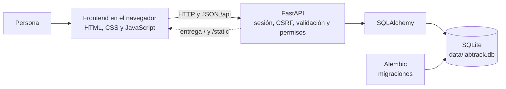
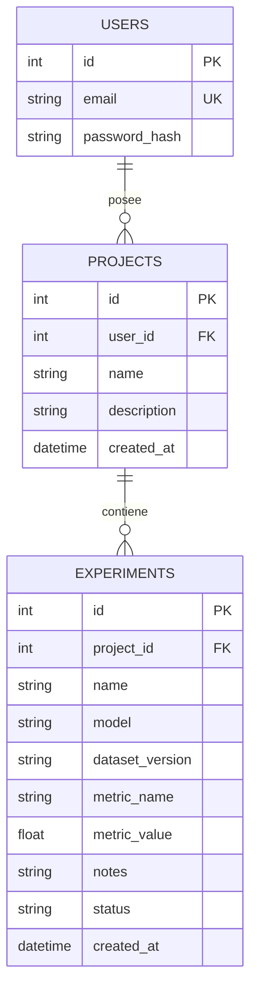

# Arquitectura de LabTrack

## Componentes

| Capa | Dónde está | Responsabilidad |
|---|---|---|
| Frontend | `frontend/` | V2 en `index.html`, `theme.css`, `panel.js` y `usuarios.js`; V1 original en `frontend/v1/` |
| API | `app/routes/` | Rutas de auth, proyectos y experimentos |
| Seguridad | `app/security.py` | Sesión por cookie, token CSRF y origen permitido |
| Administración | `app/routes/admin.py` | `GET/POST /api/admin/users`: solo para `ADMIN_EMAILS`; crea cuentas con contraseña Argon2 y lista usuarios con sus conteos |
| Validación | `app/schemas.py` | Campos obligatorios, longitudes, tipos y rechazo de campos extra |
| Indicadores | `app/routes/insights.py`, `frontend/panel.js` | `GET /api/insights`: mejor resultado por proyecto según la métrica (F1/AUC mayor, RMSE/MAE menor); gráfica de evolución, tarjetas y último récord |
| Modelo | `app/models.py` | Tablas y relaciones en SQLAlchemy |
| Esquema | `migrations/` | Cambios de la BD versionados con Alembic |

La interfaz y la API comparten origen: la separación es de responsabilidades, no de servidores.

## Modelo de datos (ERD)

- Un usuario tiene muchos proyectos; un proyecto tiene muchos experimentos.
- `EXPERIMENTS` no guarda `user_id`: el propietario se obtiene a través de su proyecto.
- Un proyecto con experimentos no se puede borrar (la API responde **409**).
- `status` acepta `planned`, `completed` o `discarded` (migración `0002`).
- Tablas de soporte: `auth_sessions` (hash del token, CSRF y expiración), `login_throttles` (intentos de acceso) y `alembic_version` (migración aplicada).

## ¿Qué pasa al pulsar Guardar?

Ejemplo: crear el proyecto "Clasificación de materiales".

1. **Navegador** (`frontend/app.js`): el evento `submit` del formulario convierte los campos en JSON (`{"name": ..., "description": ...}`) y hace `fetch("POST /api/projects")`. El navegador adjunta la cookie de sesión y el script agrega la cabecera `X-CSRF-Token`.
2. **Sesión y CSRF** (`app/security.py`, `get_current_user`): FastAPI busca el hash del token de la cookie en `auth_sessions`, comprueba que no haya expirado, que el origen sea el permitido y que el token CSRF coincida. Si algo falla responde 401 o 403.
3. **Validación** (`app/schemas.py`, `ProjectInput`): Pydantic exige `name` de 1 a 120 caracteres y rechaza campos extra como `user_id`. Si no cumple responde **422**.
4. **Lógica y persistencia** (`app/routes/projects.py`, `create_project`): crea `Project` con el `user_id` **de la sesión**, nunca del formulario, y `db.commit()` confirma la transacción en SQLite.
5. **Respuesta**: la API devuelve **201** con el proyecto y su `id`; `app.js` cierra el diálogo, vuelve a consultar la lista y muestra "Cambios guardados". `panel.js` pide `GET /api/insights` para actualizar las tarjetas, el último récord y la gráfica.
