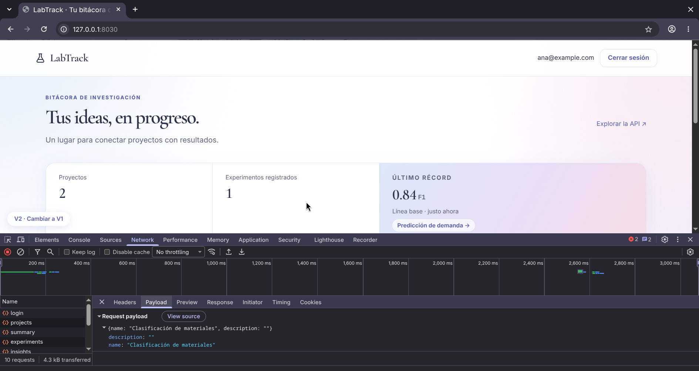
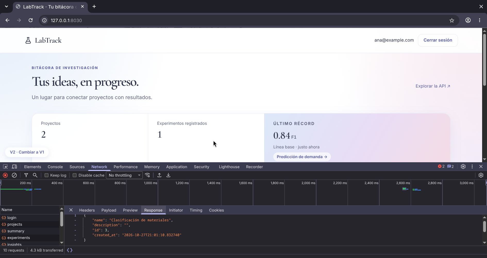
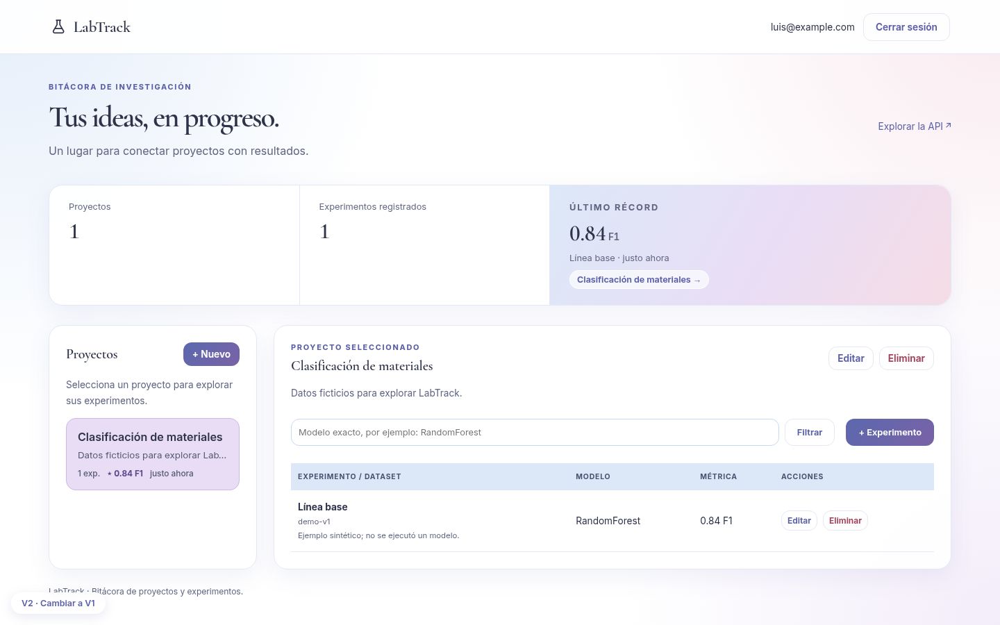
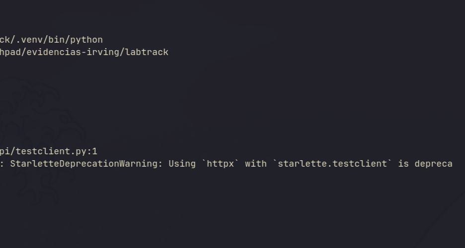
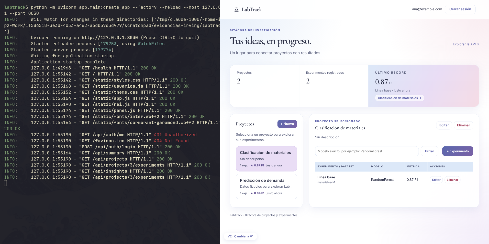

# Evidencias de los ejercicios

Datos ficticios creados con `seed-demo`. Ninguna captura muestra cookies, contraseñas ni tokens.

## Ejercicio 1 · Una petición completa

Se creó el proyecto "Clasificación de materiales" con la pestaña Network abierta.

**Explicación.** En el **navegador** se ejecuta `frontend/app.js`: toma los campos del formulario, arma el JSON `{"name", "description"}` y lo envía con `fetch` a `POST /api/projects`. En el **servidor**, FastAPI valida la sesión y el token CSRF (`app/security.py`), Pydantic valida los campos con `ProjectInput` (`app/schemas.py`) y la ruta `create_project` (`app/routes/projects.py`) crea el registro con el `user_id` tomado de la sesión. SQLAlchemy lo guarda en la tabla `projects` (`app/models.py`) y la respuesta 201 devuelve el `id` asignado por la base de datos. El navegador nunca decide el propietario.

## Ejercicio 2 · Reglas y aislamiento

| Paso | Resultado | Captura |
|---|---|---|
| Registrar experimento RandomForest, materiales-v1, F1 = 0.84 | Se crea y aparece en la tabla |  |
| Cambiar el valor a 0.87 | La tabla muestra 0.87 |  |
| Filtrar por RandomForest, por un modelo inexistente y limpiar | 1 resultado, lista vacía y de nuevo todos |  |
| Borrar el proyecto con experimentos | Rechazado: la API responde 409 |  |
| Entrar como Luis en otra sesión | Solo aparece su proyecto de demostración (también se llama «Clasificación de materiales», pero con descripción «Datos ficticios…» y 0.84 F1). El de Ana, sin descripción y con 0.87, no aparece |  |
| `pytest tests/test_domain.py -k tenant` | `PASSED`: los IDs ajenos responden 404 |  |

**Autenticación frente a autorización.** La **autenticación** responde *quién eres*: el login verifica la contraseña con Argon2 y entrega una cookie de sesión. La **autorización** responde *qué puedes tocar*: en cada consulta la API filtra por el propietario (`owned_project` y `owned_experiment`). Luis está autenticado, pero no está autorizado para ver los datos de Ana (y si intentara usar el panel de usuarios, la API le respondería **403**, porque no está en `ADMIN_EMAILS`); por eso la prueba recibe **404** en las 8 operaciones sobre IDs ajenos. Se usa 404 y no 403 para no revelar que el registro existe. Ocultar un botón en la interfaz no protegería la API: la comprobación ocurre en el servidor.

## Ejercicio 3 · Persistencia y reproducción

Se detuvo Uvicorn con Ctrl + C, se volvió a arrancar y el experimento seguía registrado.

**Explicación.** Los datos no viven en la memoria del proceso sino en el archivo SQLite `data/labtrack.db`; al reiniciar, la aplicación vuelve a leer ese archivo. Si se borrara `data/` (equivalente a `docker compose down -v` en la ruta avanzada, que elimina el volumen), se perderían los registros.

**Reproducción.** Otro integrante del equipo clonó el repositorio en una carpeta limpia y siguió el README: creó su propio `.env` con `init_env.py`, aplicó las migraciones, cargó `seed-demo` y la aplicación arrancó. Como su configuración es nueva, su base de datos solo tiene los datos iniciales, no los registros de este equipo.
