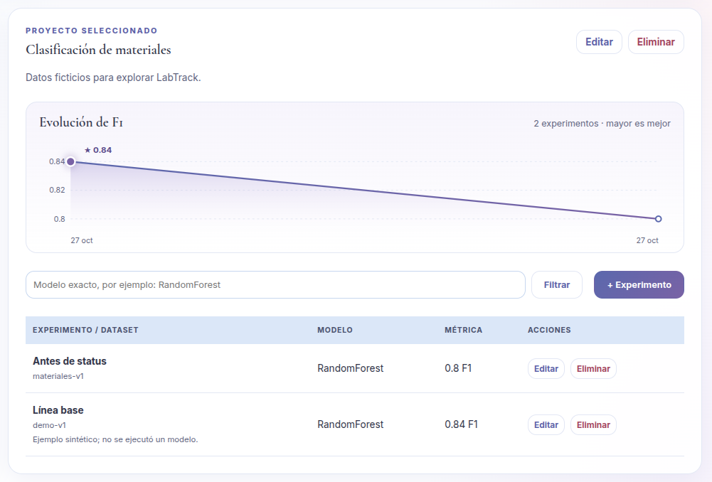
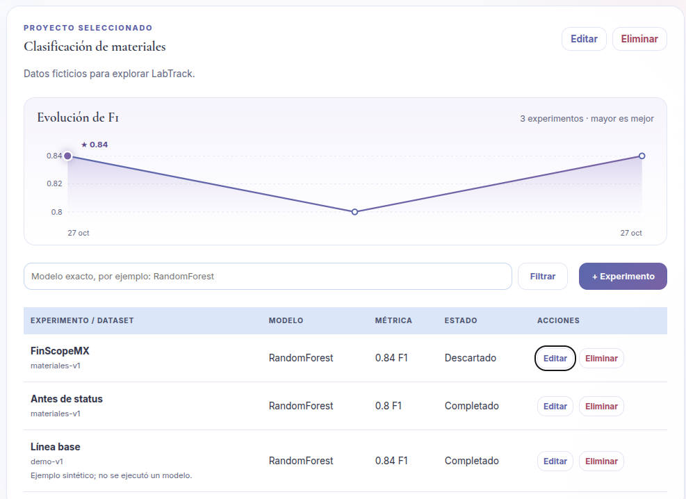

# Mejora propia: estado de los experimentos

## Qué se agregó

Cada experimento tiene ahora un campo `status` con tres valores: `planned` (Planeado), `completed` (Completado) y `discarded` (Descartado). Sirve para registrar experimentos que todavía no se ejecutan o que se descartaron, no solo los terminados.

| Capa | Archivo | Cambio |
|---|---|---|
| Modelo | `app/models.py` | Columna `status`, texto de 20, valor por defecto `completed` |
| Migración | `migrations/versions/0002_experiment_status.py` | `add_column` con `server_default="completed"`; `downgrade` con `batch_alter_table` |
| Validación | `app/schemas.py` | `Literal["planned", "completed", "discarded"]`; cualquier otro valor responde 422 |
| Interfaz | `frontend/index.html`, `app.js`, `styles.css` | Selector en el formulario y columna *Estado* en la tabla |
| Prueba | `tests/test_domain.py` | `test_experiment_status`: valor por defecto, valor válido, rechazo de `archived` y conservación al editar sin `status` |

## Por qué una migración y no solo cambiar la clase

La clase `Experiment` en Python solo describe cómo el programa lee y escribe la tabla. La base de datos que ya existe en `data/labtrack.db` no cambia al editar la clase: si solo se modificara el modelo, SQLAlchemy intentaría leer una columna `status` que no existe y la aplicación fallaría.

La migración `0002` altera la tabla real con `ALTER TABLE ... ADD COLUMN`, conservando las filas. Alembic guarda en `alembic_version` qué migración se aplicó, de modo que cualquier copia del proyecto llega al mismo esquema con `alembic upgrade head`, sin borrar la base de datos.

## Por qué los experimentos anteriores quedaron en `completed`

La columna se creó con `server_default="completed"`. La base de datos rellena ese valor en las filas que ya existían, y la regla de negocio dice que lo registrado antes del cambio eran resultados terminados.

## Evidencia

Antes de la migración: experimento "Antes de status" creado con la versión anterior.

Después de `alembic upgrade head`: el mismo experimento se conserva como *Completado* y uno nuevo se registró como *Descartado*.

## Relación con la V1

La aplicación tiene dos interfaces sobre la misma API: la **V2** (`/`), que muestra el selector y la columna *Estado*, y la **V1** (`/v1`), copia original de la plantilla del taller que se conserva como respaldo y no conoce este campo. Por eso:

- Un experimento creado desde la V1 queda en `completed`, el valor por defecto.
- Editar desde la V1 **no** cambia el estado: la API conserva los campos opcionales que no llegan en la petición. La prueba lo comprueba.

## Pruebas

`python -m pytest -q`: todas las pruebas pasan, incluida `test_migrations_match_models_and_are_repeatable`, que aplica, revierte y vuelve a aplicar las migraciones.
